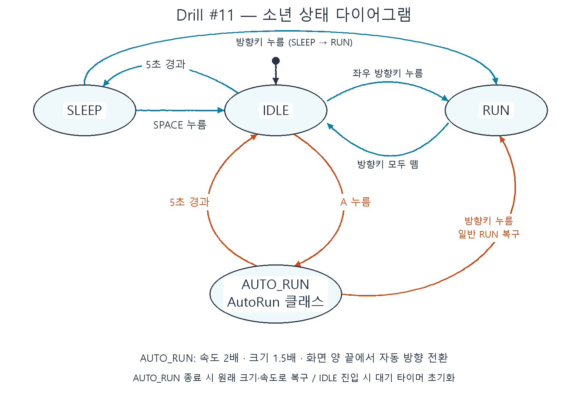

# Drill #11 — AutoRun

게임 2D 프로그래밍 실습 과제. 기존 소년 상태 머신에 자동 무적 런 상태를 추가합니다.

## 실행
Python 3.14 / Windows에서 검증했습니다. 저장소 폴더에서 실행하세요.

```powershell
python -m pip install -r requirements.txt
python main.py
```

세부 요구사항과 개발 계획은 [PRD.md](PRD.md)를 참고하세요.

## 조작과 동작

| 입력 | 동작 |
|---|---|
| A | IDLE에서 AutoRun 시작 |
| 왼쪽 / 오른쪽 | 일반 달리기. AutoRun 중이면 취소하고 누른 방향으로 달리기 |
| 방향키 모두 떼기 | 일반 RUN에서 IDLE로 복귀 |
| 스페이스 | SLEEP에서 깨어나기 |
| Esc / 창 닫기 | 종료 |

- AutoRun은 별도 `AutoRun` 클래스로 구현했습니다.
- 일반 RUN: 3픽셀/프레임, 100×100. AutoRun: 6픽셀/프레임, 150×150.
- AutoRun은 키를 떼어도 자동 이동하며, 확대된 크기를 기준으로 화면 양 끝에서 방향을 바꿉니다.
- 실제 시간 5초 후 IDLE로 복귀하고, 방향키로 중단하면 즉시 일반 크기와 속도로 복구합니다.
- IDLE에서 5초간 대기하면 SLEEP으로 전환합니다. 다시 IDLE로 들어올 때 타이머를 초기화합니다.

## 상태 다이어그램



수정 가능한 Mermaid 원본은 [state_diagram.mmd](state_diagram.mmd)에 있습니다.

## 파일 구성

- `main.py`: 게임 루프와 입력 전달
- `boy.py`: IDLE / SLEEP / RUN / AUTO_RUN 상태 머신
- `auto_run.py`: AutoRun 전용 상태 클래스
- `grass.py`: 지면 표시
- `animation_sheet.png`, `grass.png`: 실행 이미지
- `PRD.md`: 요구사항과 개발 계획
- `state_diagram.png`: 제출용 상태 다이어그램 이미지
- `tests/test_autorun.py`: 상태 전환·시간·속도·크기·경계 검증

## 검증

```powershell
python -m unittest discover -s tests -v
```

12개 자동 테스트를 통과했습니다. 실제 pico2d 게임 실행에서도 5초 후 복귀,
양 끝 자동 방향 전환, 방향키 취소, 일반 RUN의 크기·속도 복구를 확인했습니다.

## 제출

과제별 공개 저장소와 기능별 개발 커밋을 사용하며, 코드·실행 이미지·PRD·상태
다이어그램을 함께 제공합니다. e-Class에는 이 저장소의 `.git` 주소를 제출합니다.
